# NED-Net User Manual

**Neural Event Detection Network**, v1.0

A desktop application for detecting, reviewing and quantifying seizures and interictal spikes in
long-term rodent EEG.

---

## Table of Contents

1. [Introduction](#1-introduction)
2. [Installation](#2-installation)
3. [Getting Started](#3-getting-started)
4. [Loading Data](#4-loading-data)
5. [EEG Viewer](#5-eeg-viewer)
6. [Seizure Detection: Rule-Based Methods](#6-seizure-detection-rule-based-methods)
7. [Seizure Detection: U-Net and Convulsive Classifier](#7-seizure-detection-u-net-and-convulsive-classifier)
8. [Result Filters, Event Table and Inspector](#8-result-filters-event-table-and-inspector)
9. [Exporting Detected Events](#9-exporting-detected-events)
10. [Training: Reviewing Seizures](#10-training-reviewing-seizures)
11. [Interictal Spikes](#11-interictal-spikes)
12. [Datasets and Model Training](#12-datasets-and-model-training)
13. [Analysis](#13-analysis)
14. [Results](#14-results)
15. [Projects and Batch Processing](#15-projects-and-batch-processing)
16. [Parameters and Settings](#16-parameters-and-settings)
17. [Tools](#17-tools)
18. [Files](#18-files)
19. [Keyboard Shortcuts](#19-keyboard-shortcuts)
20. [Headless Use and HPC](#20-headless-use-and-hpc)

---

## 1. Introduction

NED-Net is a desktop application for researchers who work with long-term EEG from rodent models
of epilepsy. It offers two routes to detection.

- **Rule-based detectors** need no training: Spike-Train, Spectral Band, Autocorrelation and
  Ensemble. They are useful for exploring a new recording and for proposing first candidates.
- **A trained two-stage model** works at scale:
  - a 1-D **U-Net** finds seizures;
  - an optional **convulsive classifier** labels each one convulsive or non-convulsive.

Both routes feed the same review tool. Candidates are confirmed or rejected in the **Training**
tab, and the reviewed events become training data for the next model.

> **Plan to retrain on new animals.** A model trained on one cohort transfers poorly to animals it
> has not seen: implants and electrodes differ, and so does each animal's background EEG. The
> intended workflow is to review a sample of detections from each new cohort and retrain.
> Analysis can send its output straight to the review queue for this.

NED-Net runs locally and no data leaves your computer. It needs no internet connection.

### Supported file formats

- **EDF / EDF+:** the format for all detection, review and model features.
- **ADICHT (LabChart):** can be opened for viewing on Windows. Convert to EDF with
  **Tools → ADICHT → EDF** for everything else.

---

## 2. Installation

No advanced Python knowledge is needed.

### 2.1 Prerequisites

You need **Python 3.9 or later** (3.11 or later recommended). To check, open a terminal (or
Command Prompt on Windows) and type `python --version` or `python3 --version`. If you do not
have Python, install it from [python.org](https://www.python.org/downloads/) or with
[Miniconda](https://docs.conda.io/en/latest/miniconda.html).

Optional:
- **ffmpeg**, for the video converter.
- **Linux only:** `zenity` or `kdialog`, for the Browse dialogs. Most desktops ship one.

### 2.2 Download NED-Net

```bash
git clone https://github.com/EpilepsyCenter/NED-Net.git
cd NED-Net
```

Or download the ZIP from GitHub (green **Code** button → **Download ZIP**) and open a terminal in
the unzipped folder.

### 2.3 Create a virtual environment

A virtual environment keeps NED-Net's packages separate from other software.

```bash
python -m venv .venv
source .venv/bin/activate        # macOS / Linux
.venv\Scripts\activate           # Windows
```

The prompt now starts with `(.venv)`. The desktop launchers (section 3.1) expect the environment
to be called `.venv` and to sit inside the NED-Net folder.

### 2.4 Install

```bash
pip install -e ".[desktop,ml]"
```

| Part | Installs | Needed for |
|---|---|---|
| core | numpy, scipy, pandas, pyEDFlib, plotly, matplotlib, dash and its components, openpyxl, watchdog | everything, incl. rule-based detection and live monitoring |
| `ml` | PyTorch | training models and running the U-Net / convulsive classifier |
| `desktop` | pywebview, waitress | the desktop app window |
| `windows` | adi-reader | opening ADICHT files (Windows only) |

PyTorch uses the GPU of Apple-silicon Macs automatically. For an NVIDIA GPU, first install the
CUDA build of PyTorch, following [pytorch.org](https://pytorch.org/get-started/locally/).

### 2.5 Updating

After `git pull`, run `pip install -e ".[desktop,ml]"` again, so new dependencies are installed.

---

## 3. Getting Started

### 3.1 Launching

**Desktop app.** Double-click the launcher for your system:

| System | Launcher | First time |
|---|---|---|
| macOS | `NED-Net.app` | — |
| Windows | `Start NED-Net (Native).bat` | — |
| Linux | `start-nednet-native.sh` | `chmod +x start-nednet-native.sh` |

Or run `nednet` in the terminal. The app opens in its own window, on port 8051, or another free
port if that one is taken.

**In a browser.** Run `python -m eeg_seizure_analyzer.dash_app.main` and open
http://127.0.0.1:8050.

### 3.2 The interface

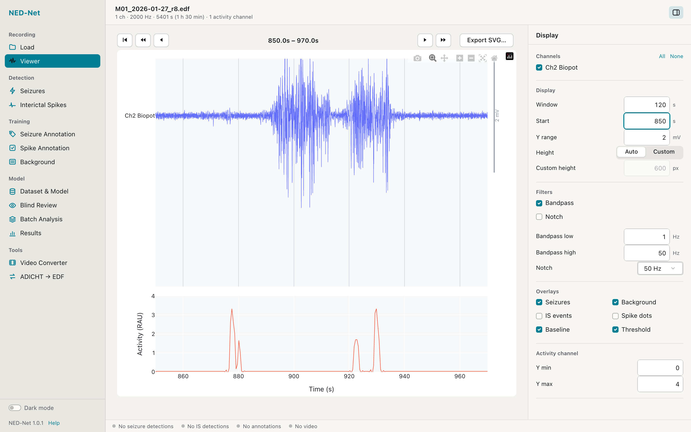

- **Sidebar (left).**
  - The loaded recording: name, channels, sampling rate, duration, and EEG↔activity pairs.
  - Status lines for seizure detections, interictal-spike detections, annotation progress and
    video. ✅ means saved to disk; ⚠️ means in memory only.
  - At the bottom, the **Dark mode** switch and a **Help** link that opens this manual.
- **Tab bar (top).** Detection and Training have subtabs (Seizure, Interictal Spikes) in a
  second row.
- **Content:** the active tab.

| Tab | Subtabs | Purpose |
|---|---|---|
| **Load** | — | Start screen, loading files and folders, animal IDs and tags |
| **Viewer** | — | Multi-channel EEG viewer |
| **Detection** | Seizure, Interictal Spikes | Rule-based and U-Net detection on the loaded recording |
| **Training** | Seizure, Interictal Spikes | Review: confirm or reject candidates, edit, add events |
| **Dataset / Model** | Dataset | Build datasets and train models |
| **Analysis** | — | Run a trained model on a file, a folder, or a watched folder |
| **Results** | — | Statistics and exports for a project |
| **Tools** | Video Converter, ADICHT → EDF | Conversions |

### 3.3 The start screen

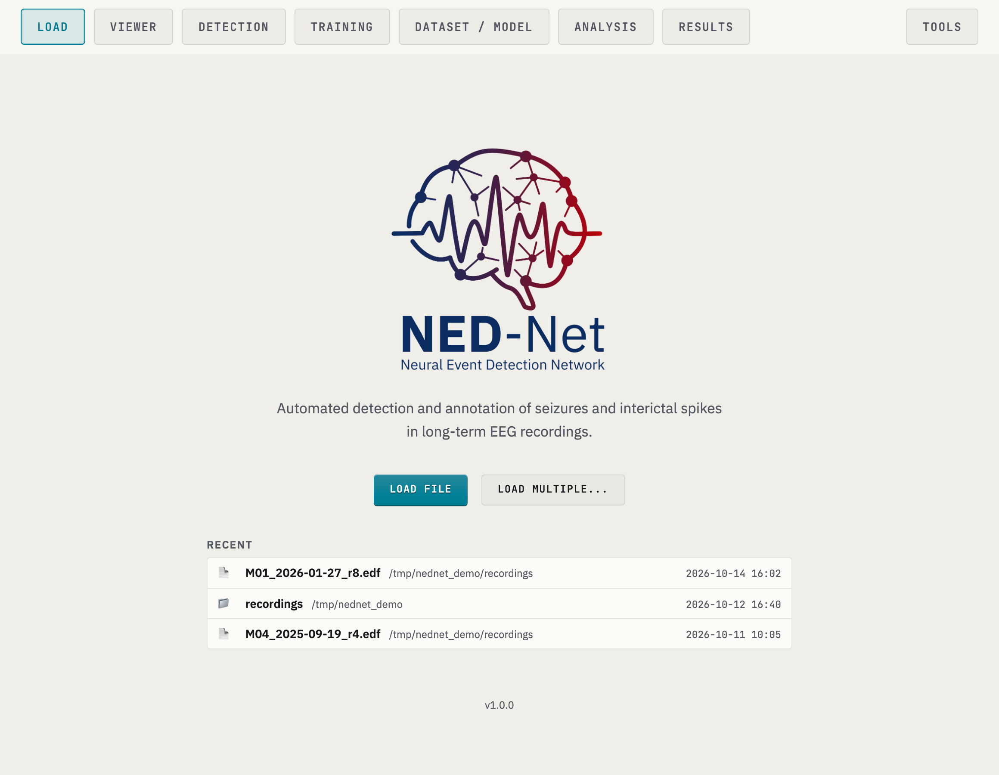

**Load File** opens one recording. **Load Multiple...** opens a folder of recordings.

Below the two buttons, **Recent** lists the last 10 files and folders you opened:
- click a **file** to go straight to channel selection;
- click a **folder** to open Load Multiple with that folder already scanned.

Entries that no longer exist are greyed out.

### 3.4 Light and dark theme

The app starts in the light theme. Switch with **Dark mode** at the bottom of the sidebar.

---

## 4. Loading Data

### 4.1 One recording

1. On the start screen, click **Load File**.
2. Type the path to the recording, or click **Browse**, then click **Load**.
3. **Channel selection.**
   - The table lists every signal: label, unit, sampling rate and samples.
   - **Detected Channel Pairings** shows which EEG channel is paired with which activity
     channel.
   - Choose the EEG channels in **Select EEG channels to load**; the EEG channels are
     preselected. A notice appears if the sampling rates differ.
4. Click **Load Selected Channels**. Any saved detections for this file load automatically.

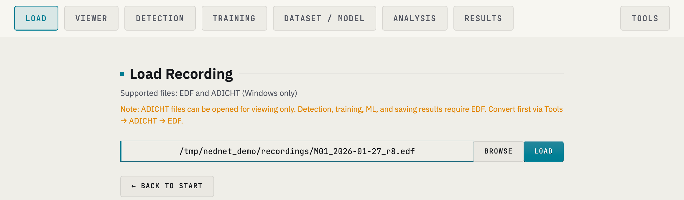

ADICHT files skip channel selection and open for viewing only.

### 4.2 Animal ID, cohort and group

After loading, the **Loaded Channels** table has editable **Animal ID**, **Cohort** and
**Group** columns. Each edit is saved at once, next to the recording:
- animal IDs in `<name>_ned_channels.json`;
- cohort and group in `<name>_ned_meta.json`.

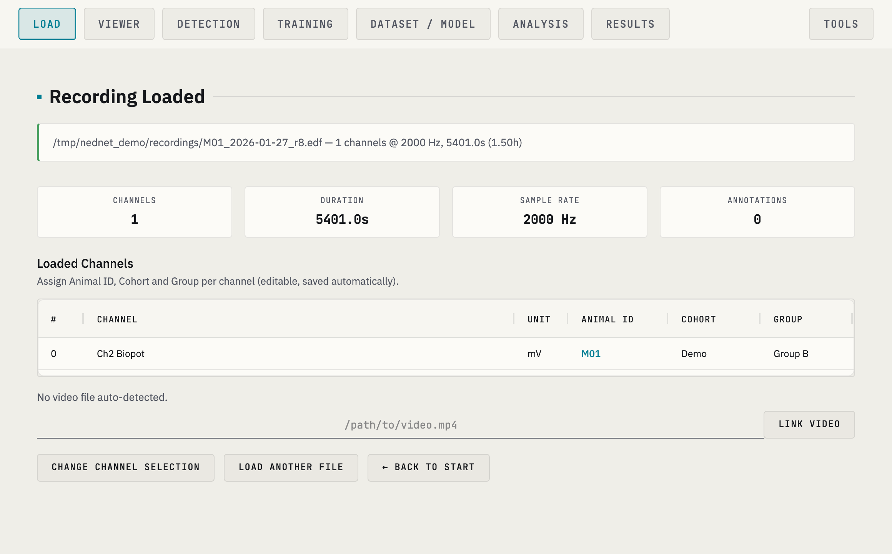

- **Every channel needs an Animal ID before detection.** Results, statistics and training data
  are all organised by animal.
- **Use the same ID for the same animal in every file.** If channel 1 is `Mouse_01` on day 1, it
  must be `Mouse_01` on day 2. Otherwise one animal is counted as two.
- **Group** is the experimental group, used for comparisons in Results. **Cohort** is the batch
  or experiment.

Other buttons on this screen:
- **Change Channel Selection:** go back to channel selection.
- **Load Another File.**
- **← Back to start.**

### 4.3 Video

NED-Net links a video automatically when a file named `<recording>.mp4` sits next to the
recording. Otherwise, enter the path and click **Link Video**. A linked video plays in the
Viewer, Training and inspector. Convert WMV recordings first with **Tools → Video Converter**.

### 4.4 Several recordings (Load Multiple)

1. Click **Load Multiple...**, choose the **Recordings folder** (**Browse**), and click **Scan**.
   The scan is not recursive.
2. The table lists each EDF with columns:
   - **Animal IDs:** ✔ if `_ned_channels.json` exists.
   - **Seizure det.:** the count in `_ned_detections.json`.
   - **Spike det.:** the count in `_ned_spikes.json`.
   - **Annotations:** the count in `_ned_annotations.json`.
3. Animal IDs for many files can come from a spreadsheet:
   - **Generate Template** writes `channel_ids.xlsx` in the folder, with a File column and one
     column per EEG channel (Ch1 = the first signal).
   - Fill it in. On the next scan it is used automatically.
4. Click **Load All**. The first file opens, with automatic channel pairing. If it cannot be
   loaded, the page says why.

Once loaded:
- **Active file** switches between the recordings.
- **Copy tags from file…** copies IDs, cohort and group, by channel index, from an
  already-tagged recording to all loaded files.
- **Apply IDs to all**, **Apply Cohorts to all** and **Apply Groups to all** copy the active
  file's values to every file, by channel index.
- **Import batch template** reads a batch metadata spreadsheet.

---

## 5. EEG Viewer

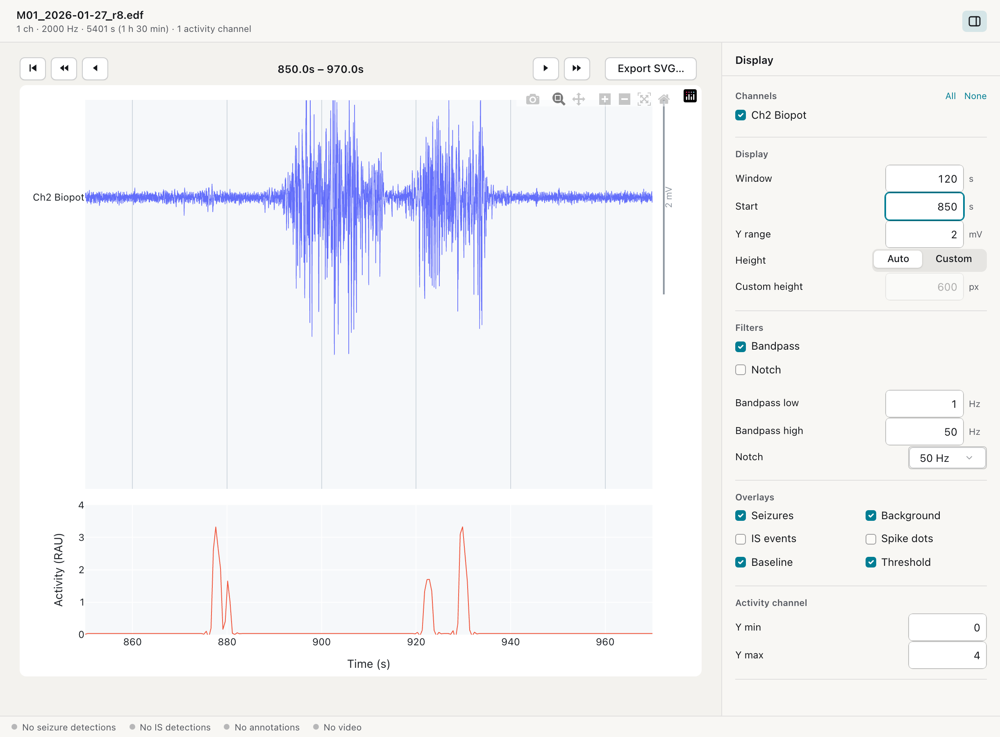

| Control | Default | What it does |
|---|---|---|
| **Channels** | all | Channels to show (**All** / **None**) |
| **Window (s)** | 150 | Length of the visible stretch |
| **Start (s)** | 0 | Start of the visible stretch |
| **Y range** | automatic | Vertical scale and channel spacing; a scale bar shows it |
| **Height (px)** | 600 | Plot height |
| **Bandpass**, **BP Low / High (Hz)** | on, 1–50 | Display filter |
| **Notch**, **Notch (Hz)** | off, 50 | Mains filter (50 or 60 Hz) |
| **Activity Y min / max** | 0 / 4 | Scale of the activity channel, shown when one is paired |

**Navigation:**
- ⏮ jumps to the start;
- ⏪ ◀ ▶ ⏩ move by five windows or one window;
- dragging on the plot zooms in, and the scroll wheel zooms.

**Overlays.**

| Overlay | Default | Shows |
|---|---|---|
| **Seizures** | on | Shaded detected seizures |
| **IS events** | off | Interictal spikes (following that tab's filters) |
| **Spike dots** | off | Spikes found by the spike-train front-end |
| **Baseline**, **Threshold** | on | The detector's baseline and threshold |

**Export SVG** saves the current view as a vector SVG file, ready for figures.

**Video.** With a linked video, the player follows the Viewer's Start position. **Sync to EEG**
jumps it back to the current Start, and clicking on the trace moves it to that time.

---

## 6. Seizure Detection: Rule-Based Methods

The **Detection → Seizure** subtab runs detection on the loaded recording. Choose the method at
the top: Spike-Train, Spectral Band, Autocorrelation, Ensemble, or U-Net (section 7). The **?**
button explains each method.

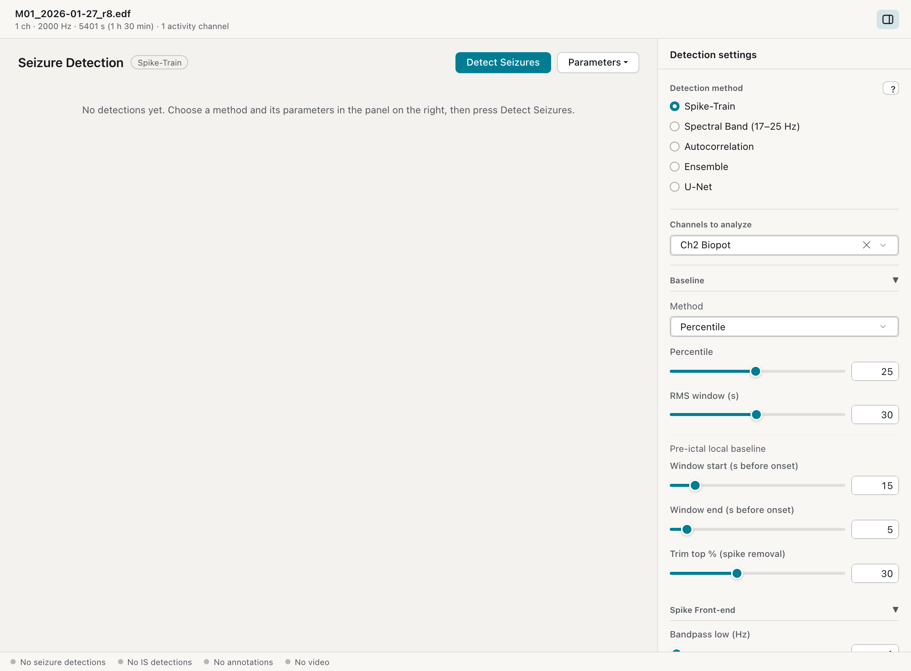

| Method | Best for | How it works |
|---|---|---|
| **Spike-Train** | Seizures with clear spiking | Detects spikes against a baseline, groups them into trains, refines the boundaries |
| **Spectral Band** | Seizures with sustained band power | Power in a 17–25 Hz band relative to 1–50 Hz (spectral band index), against its quiet baseline |
| **Autocorrelation** | Rhythmic seizures | Range autocorrelation (rhythmicity) and spike frequency; both must exceed their thresholds |
| **Ensemble** | Fewer false positives | Combines the methods by voting |

Results from different methods **accumulate**. Re-running a method replaces only that method's
earlier results.

Every parameter has a slider and a number box; type into the box for an exact value. The
**(?)** marks explain a parameter.

### 6.1 Spike-Train

**Spike front-end**

| Parameter | Default | Effect of increasing |
|---|---|---|
| **Bandpass low (Hz)** | 1 | Removes more slow drift |
| **Bandpass high (Hz)** | 50 | Keeps more high-frequency content; decrease with high-frequency artefacts |
| **Threshold (z-score)** | 3 | A spike must exceed baseline mean + z × SD. Higher = fewer false positives |
| **Min amplitude (uV)** | 0 | Absolute minimum spike height; 0 disables it. Enter it in the recording's own unit (e.g. mV for files stored in mV) |
| **Prominence (x baseline)** | 2.5 | How much a spike must stand out from its surroundings |
| **Max width (ms)** | 200 | Rejects broader deflections such as slow waves |
| **Min width (ms)** | 10 | Rejects very narrow, artefact-like spikes |
| **Refractory (ms)** | 75 | Minimum time between spikes |

**Train grouping**

| Parameter | Default | Effect |
|---|---|---|
| **Max ISI (ms)** | 500 | Largest gap between spikes in one train. Larger = merges looser trains |
| **Min spikes** | 10 | Minimum spikes per seizure |
| **Min duration (s)** | 5 | Shorter events are discarded |
| **Min inter-event (s)** | 3 | Closer events are merged |

**Baseline**

| Parameter | Default | Description |
|---|---|---|
| **Method** | Percentile | *Percentile*: the quietest part of the recording. *Rolling*: recomputed in sliding windows. *First N min*: the start of the recording |
| **Percentile** | 25 | Lower = quieter baseline |
| **RMS window (s)** | 30 | RMS window for the baseline |

**Pre-ictal local baseline.** The window before each event, used for the *local baseline ratio*
quality metric.

| Parameter | Default | Description |
|---|---|---|
| **Window start (s before onset)** | 15 | Start of the window |
| **Window end (s before onset)** | 5 | End; the gap avoids pre-ictal build-up |
| **Trim top % (spike removal)** | 30 | Largest values removed from the window |

**Boundary refinement**

| Parameter | Default | Description |
|---|---|---|
| **Method** | Signal (RMS) | *Signal (RMS)* uses the RMS envelope; *Spike density* uses the spike rate |
| **RMS window (ms)** | 100 | Envelope smoothing |
| **RMS threshold (x BL)** | 3 | Envelope level counted as ictal |
| **Max trim (s)** | 2 | Largest inward trim of a boundary |

With *Spike density*: **Window (s)** 2, **Rate threshold** 2 spikes/s, **Amp threshold (x BL)** 2.

### 6.2 Spectral Band

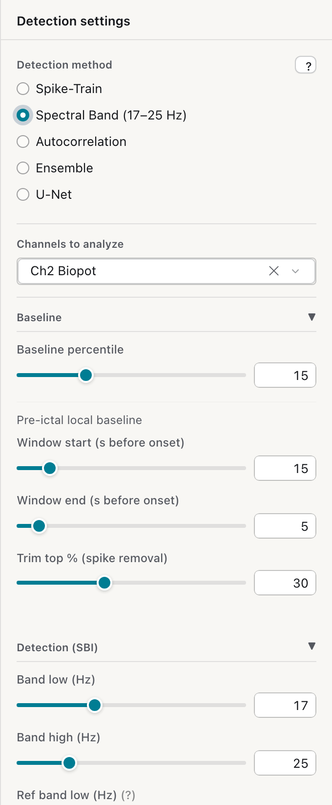

| Parameter | Default | Description |
|---|---|---|
| **Band low / high (Hz)** | 17 / 25 | Target band |
| **Ref low / high (Hz)** | 1 / 50 | Reference band |
| **Window (s)** / **Step (s)** | 2 / 1 | Analysis window and step |
| **Z-score threshold** | 3 | Lower = more sensitive |
| **Baseline percentile** | 15 | Quiet-baseline estimate |
| **Min duration (s)** / **Merge gap (s)** | 5 / 3 | Event length and merging |

Spectral Band has its own boundary-refinement and pre-ictal baseline settings, which work as in
Spike-Train.

### 6.3 Autocorrelation

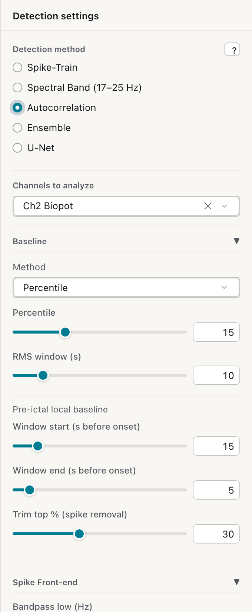

| Parameter | Default | Description |
|---|---|---|
| **Bandpass low / high (Hz)** | 1 / 100 | Filter |
| **Spike amplitude (x BL)** / **Refractory (ms)** | 3 / 50 | Spike front-end |
| **Sub-window**, **Lookahead (samples)** | 30, 60 | Range-autocorrelation settings |
| **Window (s)** / **Step (s)** | 12 / 4 | Scoring window and step |
| **Min frequency (Hz)** | 2 | Lowest rhythm counted |
| **Z-score threshold** | 3 | Lower = more sensitive |
| **Min duration (s)** / **Merge gap (s)** | 5 / 3 | Event length and merging |

### 6.4 Ensemble

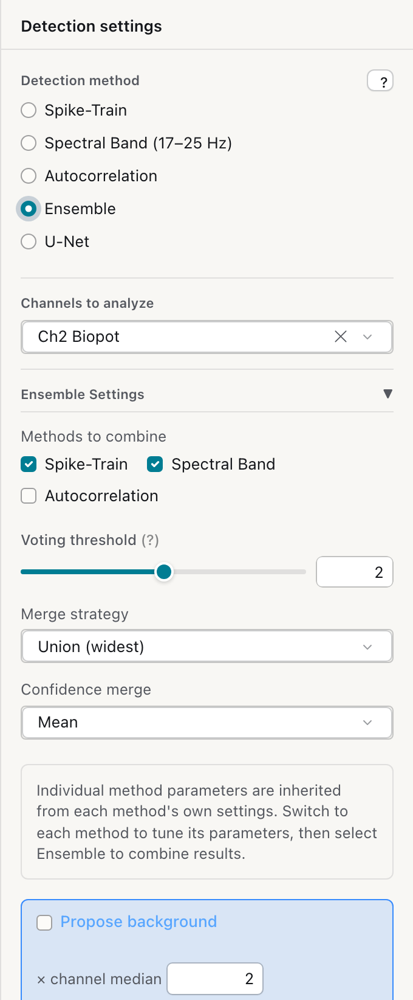

| Parameter | Default | Description |
|---|---|---|
| **Methods** | Spike-Train + Spectral Band | Methods to combine |
| **Vote threshold** | 2 | Methods that must agree. 1 = union, N = intersection |
| **Merge strategy** | Union | How overlapping events' boundaries combine |
| **Confidence merge** | Mean | Mean or max of the confidences |

Each method uses its own parameters from its own panel.

### 6.5 Running detection

1. Select channels in **Channels to analyze**.
2. Choose the method and adjust parameters.
3. Click **Detect Seizures**.

The results are saved next to the recording (`_ned_detections.json`, section 18). Their events
are also added to the review queue as *pending* (section 10).

The other action buttons:
- **Clear Results** removes the detections.
- **Add to project database** sends the events that pass the filters to the active project
  (section 15).
- **📁 Detect All Files** appears when several files are open (section 15).
- **Parameters** saves and restores settings (section 16).

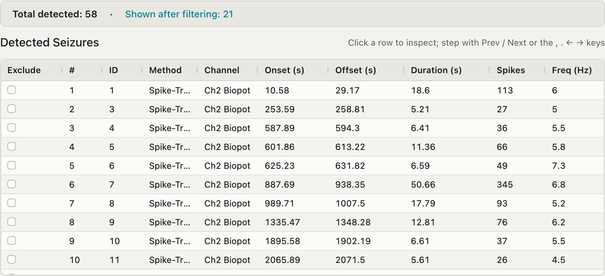

---

## 7. Seizure Detection: U-Net and Convulsive Classifier

Choose **U-Net** as the method to run a trained model on the loaded recording. To run it on many
files, use **Analysis** (section 13).

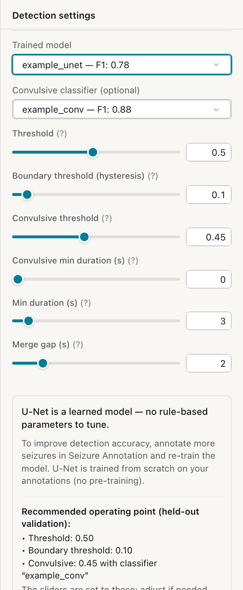

### 7.1 How it works

1. **Stage 1, the U-Net,** gives a seizure probability for every sample.
   - The EEG is resampled to 250 Hz and read in 60 s windows that overlap by 15 s.
   - Events use **hysteresis**: an event needs a *core* above the **Threshold**, then grows
     outward until the probability falls below the lower **Boundary threshold**. This captures
     the build-up and fade-out of a seizure without lowering the bar for detecting one.
   - Events shorter than **Min duration** are dropped, and events closer than **Merge gap** are
     merged.
2. **Stage 2, the convulsive classifier (optional),** looks at a 60 s crop around each detected
   event and labels it convulsive or not. It **only labels events; it never removes them**.
   Without a classifier, the U-Net's own convulsive output decides.

### 7.2 Controls

| Control | Description |
|---|---|
| **U-Net model** | A trained seizure model (section 12) |
| **Convulsive classifier** | A Stage-2 model, or none |
| **Threshold** | An event's core must exceed this probability |
| **Boundary threshold (hysteresis)** | Events grow outward to this lower probability. Equal to the threshold (or higher) turns growth off |
| **Convulsive threshold** | Probability above which an event is labelled convulsive |
| **Convulsive min duration (s)** | Events shorter than this are labelled non-convulsive whatever the classifier says. They stay detected as seizures, and keep their convulsive probability. 0 (the default) turns it off |
| **Min duration (s)** / **Merge gap (s)** | Event length and merging |

Convulsive seizures typically last 20-90 s, so a classifier calling a 5 s event convulsive is
usually wrong. A minimum of about 15 s removes those calls. The default is off so that results
match the validated operating points below, which were measured without it.

### 7.3 Recommended operating points

When you choose a model, the thresholds and classifier are set to its **recommended operating
point**, and a note says where it came from. You can still change them. The source is, in order:

1. an operating point stored with the model: an `operating_point` entry in the model's
   `metadata.json`, for a point you validated yourself, e.g.
   `"operating_point": {"threshold": 0.5, "boundary": 0.1, "convulsive_model": "my_conv",
   "convulsive_threshold": 0.45, "source": "held-out validation"}`;
2. otherwise, the **training optimum**: the threshold that gave the best event F1 on validation
   during training. This is a reasonable start, but it is not the same as an operating point
   chosen for a real study.

If you change the classifier, only the convulsive threshold follows it.

---

## 8. Result Filters, Event Table and Inspector

### 8.1 Result filters

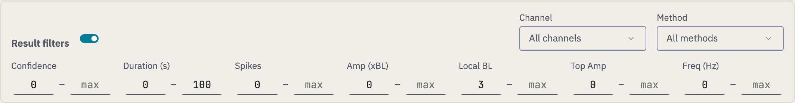

The **Result filters** panel narrows which detections are shown. The switch turns all filters
on or off. **Channel** and **Method** are in the header. The min–max ranges are:

| Filter | Range on |
|---|---|
| **Confidence** | Detector confidence (0–1) |
| **Duration (s)** | Event duration |
| **Spikes** | Spikes in the event |
| **Amp (xBL)** | Peak amplitude relative to baseline |
| **Local BL** | Local baseline ratio (event vs the pre-ictal window) |
| **Top Amp** | Amplitude of the largest spikes |
| **Freq (Hz)** | Mean spike frequency |

If the filters hide every detection, the page says so ("All 3 detected seizures are hidden by
the filters") and offers **Show all (turn filters off)**.

> U-Net events carry no spike counts, so a minimum on **Spikes**, **Top Amp** or **Freq** hides
> all of them. Leave those at 0 when reviewing model output.

### 8.2 The event table and navigation

The table lists the filtered events with sortable columns. **Click a row** to open it in the
inspector.

To step through events:
- **◀ Prev** and **Next ▶** under the table, which show "Seizure x of N";
- the keys **`,` `.`** or **`←` `→`**.

Stepping follows the table's current sort order. While the table itself has keyboard focus, the
arrow keys move between cells instead.

### 8.3 The event inspector

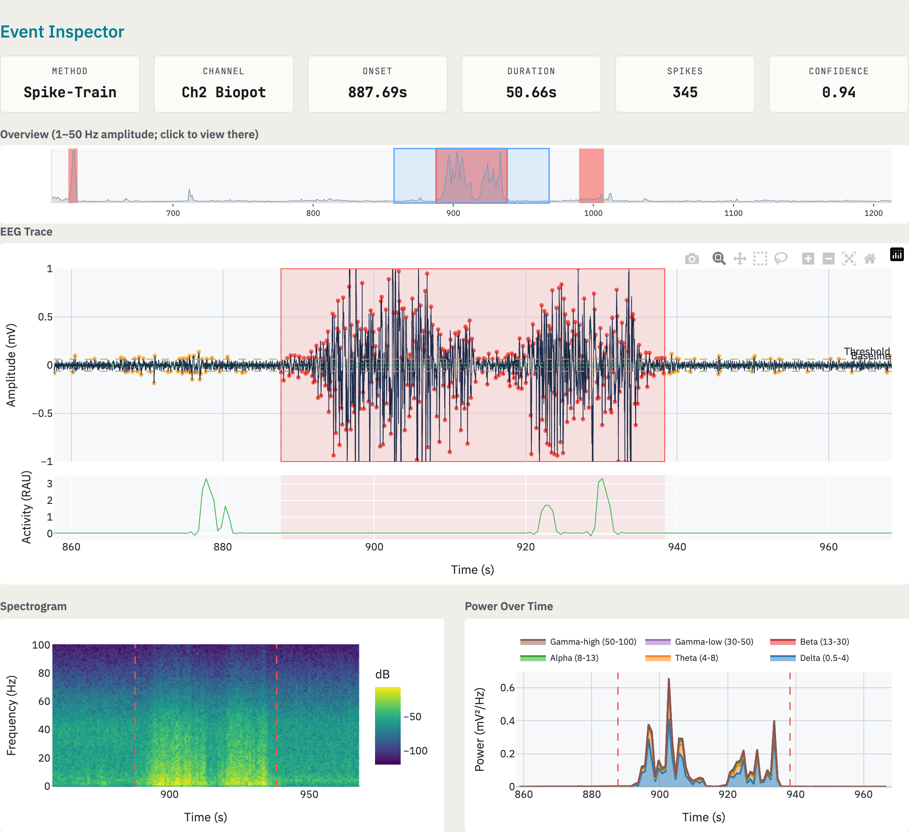

The inspector shows:
- metric cards for the event;
- an **overview strip**;
- the **EEG trace** with the event shaded, and the activity channel if paired;
- a **spectrogram** and **power over time** in the standard bands.

For spectral-band and autocorrelation events, method-specific plots appear too.

**Looking beyond the event.** Detected boundaries are not always the seizure's true extent.

| Control | Key | What it does |
|---|---|---|
| **◀ [** / **] ▶** | `[` / `]` | Pan back or forward by half a view. The event itself does not change |
| **Centre \\** | `\` | Centre the view on the event again |
| **Context** | — | Seconds shown either side of the event: ±10, ±30, ±60 or ±120 s. Remembered between events |
| **Overview** | — | Span of the overview strip: ±5 min, ±15 min or the whole recording |

**The overview strip** plots the channel's 1–50 Hz amplitude per second, relative to its median,
so seizures stand out as bumps. It also marks the other events on the channel and the current
view (blue box). **Click anywhere on it** to centre the view there. Large artefacts can be as
tall as seizures, so a bump means "worth a look".

All plots follow the view: trace, activity, spectrogram, power and video. Each new event opens
centred again.

**Inspector options:**
- **Spikes**, **Baseline**, **Threshold** overlays;
- **Bandpass Filter** for the displayed trace;
- **Y range**.

### 8.4 Event features and quality metrics

Every detected event carries features and quality metrics. They appear in the inspector, drive
the filters and go into exports.

**Features (shared)**

| Feature | Description |
|---|---|
| **n_spikes** | Spikes detected in the event |
| **mean_spike_frequency_hz** | Mean spike rate (spikes/s) |
| **max_amplitude_x_baseline** | Largest spike, as a multiple of baseline |
| **mean_isi_ms** | Mean inter-spike interval |
| **spike_regularity** | Coefficient of variation of the ISI; lower = more regular |
| **mean_amplitude_uv**, **max_amplitude_uv** | Spike amplitudes in the recording's unit |

**Method-specific features**
- **Spike-Train:** mean_amplitude_x_baseline, isi_cv, amplitude_trend, frequency_trend,
  has_postictal_suppression, first_half_freq_hz, second_half_freq_hz.
- **Spectral Band:** sbi_peak, sbi_mean, sbi_threshold, band_hz.
- **Autocorrelation:** peak_acorr, mean_acorr, acorr_threshold.
- **Ensemble:** contributing_methods, n_methods.
- **U-Net:** peak_probability, mean_probability, convulsive_probability.

**Quality metrics**

| Metric | Description |
|---|---|
| **local_baseline_ratio** | Event RMS relative to the pre-ictal window. Higher = stands out more |
| **top_spike_amplitude_x** | Mean of the largest 10% of spikes, × baseline |
| **peak_ll_zscore**, **peak_energy_zscore** | Peak line length and energy relative to baseline |
| **signal_to_baseline_ratio** | Signal relative to baseline over the event |
| **theta_delta_ratio** | Theta (4–8 Hz) to delta (0.5–4 Hz) power |
| **activity_zscore** | Activity channel during the event, if paired; flags movement |

---

## 9. Exporting Detected Events

The export panel sits at the bottom of each Detection subtab.

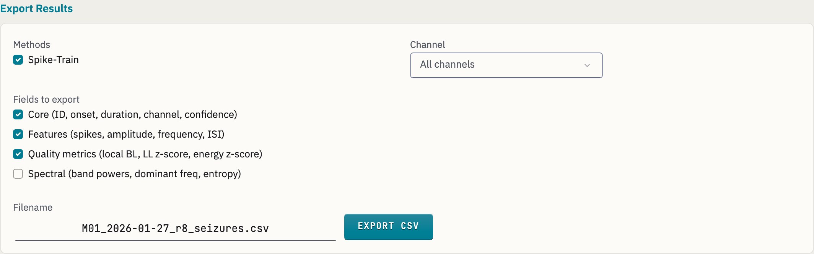

| Control | Description |
|---|---|
| **Methods** | Detection methods to include |
| **Channel** | One channel, or all |
| **Fields to export** | Column groups (below) |
| **Filename** | Pre-filled from the recording name |
| **Export CSV** | Save the file |

**Seizure field groups:**

| Group | Columns |
|---|---|
| **Core** | ID, onset, offset, duration, channel, channel name, animal ID, method, confidence |
| **Features** | The features in section 8.4 (blank where a method does not compute one) |
| **Quality metrics** | The quality metrics in section 8.4 |
| **Spectral** | Band powers (absolute and relative), total power, dominant frequency, spectral entropy, computed at export time from each event's EEG |

**Interictal-spike field groups:**

| Group | Columns |
|---|---|
| **Core** | ID, time, channel, amplitude, confidence |
| **Morphology** | duration, sharpness, phase ratio, SNR, rise and fall time |
| **Context** | baseline, threshold, neighbours, after-slow-wave, isolation |
| **Spectral** | band powers, dominant frequency, entropy (1 s window around each spike) |

With several files open, the export covers the **active file**.

---

## 10. Training: Reviewing Seizures

The **Training → Seizure** subtab is where candidates become labels. Reviewed events are the only
source of training data.

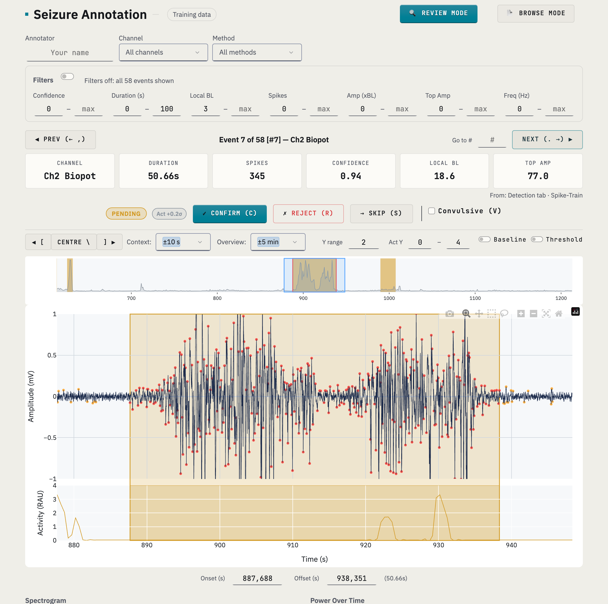

### 10.1 Where candidates come from

Every candidate starts as **pending**. Candidates enter the review queue from:
- a seizure detection run on the **Detection** tab;
- **Detect All Files**;
- **Analysis** with the *Training review queue* output (section 13), in single, batch or live
  mode;
- events you **add by hand** (Browse mode).

Under the event cards, **From:** says where each one came from and which method found it, e.g.
"From: Analysis (live monitoring) · U-Net".

### 10.2 Labelling

| Action | Button | Key |
|---|---|---|
| Confirm (a real seizure) | **✓ Confirm (C)** | `C` |
| Reject (not a seizure) | **✗ Reject (R)** | `R` |
| Skip for now | **→ Skip (S)** | `S` |
| Mark convulsive or not | **Convulsive (V)** | `V` |
| Previous / next event | **◀ Prev** / **Next ▶** | `←` `,` / `→` `.` |
| Go to event number | **Go to #** box | — |

Confirm and Reject move on to the next pending event. Each label is saved at once.

The status badge next to the buttons shows the current label: pending, confirmed or rejected.

### 10.3 Looking around and editing boundaries

Above the plot, the **plot toolbar** holds two groups of controls.
- **Left:** pan (**◀ [**, **Centre \\**, **] ▶**), **Context** and **Overview**, as in the
  inspector (section 8.3). Use them to see where a seizure really starts and ends.
- **Right:** **Y range**, **Act Y** (activity range), and the **Baseline** and **Threshold**
  overlays.

The overview strip above the plot marks the channel's annotations by label: amber pending, green
confirmed, red rejected.

Edit boundaries in either of two ways:
- **drag the edges** of the shaded box on the plot (saved at once);
- type new values in **Onset (s)** / **Offset (s)** below the plot (applied when you confirm or
  reject).

The original boundaries are kept with the annotation. Edits here change only the annotation file,
never the Detection tab's results.

### 10.4 Filters

The Training filters start from the Detection tab's filter values. Next to the **Filters**
switch, a summary always shows what they do, e.g. "Filters on: 12 of 40 events shown". If they
hide everything, the plot says so. **Channel** and **Method** narrow the queue further.

### 10.5 Notes, video and progress

- **Annotator** stores your name with each label.
- **Notes** adds free text to the current event.
- With a linked video, the video jumps to each event and follows the view when you pan.
- At the bottom, the progress line counts all annotations of the file ("X of N reviewed …") and
  per channel.

### 10.6 Browse mode

**📄 Browse Mode** scrolls freely through the recording (**Window (s)**, **Start (s)**,
**Channels**) to find seizures the detector missed.
- **Add Seizure:** turn it on, choose **Channel (for manual add)**, then box-select the seizure
  on the plot. It is added as confirmed, convulsive or not as set by the **Convulsive** box
  next to the buttons (the box keeps its setting; check it before each selection). Convulsive
  annotations are marked **C** on the plot. To change one afterwards, use the Convulsive
  toggle in Review mode.
- **Remove Seizure:** turn it on, then click a seizure to delete it.

### 10.7 What becomes training data

Model training uses **confirmed** events as positives and **rejected** events as hard negatives.
**Pending events are never used** until someone reviews them. Convulsive flags on confirmed
events train the convulsive outputs.

---

## 11. Interictal Spikes

### 11.1 Detection

The **Detection → Interictal Spikes** subtab detects isolated spikes between seizures. Choose
**Classical** or **U-Net** (a trained spike model) at the top.

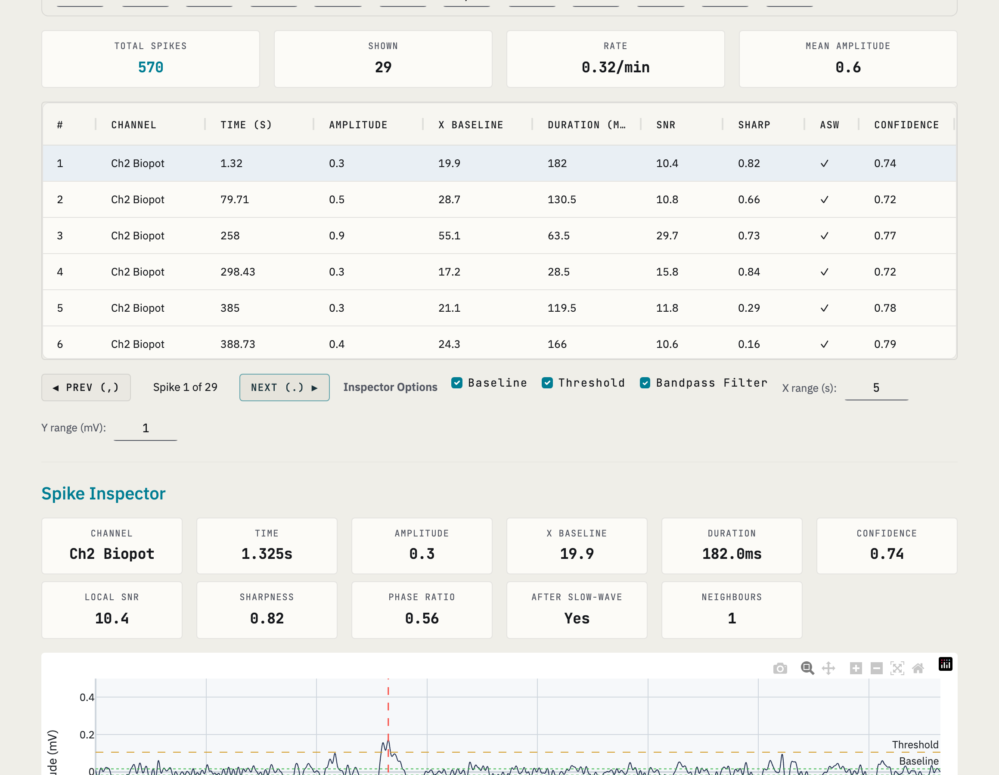

**Classical parameters**

| Group | Parameter | Default |
|---|---|---|
| Detection | Bandpass low / high (Hz) | 3 / 50 |
| | Threshold (z-score) | 7 |
| | Min amplitude (uV); 0 disables it | 0 |
| Morphology | Prominence (x baseline) | 6 |
| | Max / Min width (ms) | 300 / 10 |
| | Refractory (ms) | 750 |
| Baseline | Method / Percentile / RMS window (s) | Percentile / 25 / 30 |
| Isolation (all methods) | Isolation window (s) | 2 |
| | Max neighbours | 1 |

**Isolation** drops spikes with more neighbours than allowed within the window, so bursts and
seizures are not counted as interictal spikes. It also applies to U-Net results.

**U-Net parameters:** **Trained spike model**, **Threshold** 0.5, **Min duration (ms)** 2,
**Merge gap (ms)** 50.

**Result filters.** By default, at least 15 × baseline, confidence 0.7 and SNR 10. Ranges cover
Amplitude, x Baseline, Duration (ms), Confidence, Local SNR, Sharpness, plus Channel.

**Results:**
- cards: Total Spikes, Shown, Rate (/min), Mean Amplitude;
- a table and a spike-rate plot.

Step through spikes with **◀ Prev / Next ▶**, `,` `.` or `←` `→`. The **spike inspector** shows
the waveform and its features: amplitude, x baseline, duration, SNR, sharpness, phase ratio,
after-slow-wave, neighbours.

The buttons match the seizure subtab: **Detect Spikes**, **Clear Results**, **Add to project
database**, **📁 Detect All Files** (several files open) and **Parameters**.

### 11.2 Review

**Training → Interictal Spikes** works like seizure review:
- **Confirm / Reject / Skip** with `C` `R` `S`, and `←` `,` / `→` `.` to move;
- edit the extent by dragging or with the Onset/Offset boxes;
- **Browse mode** with **Add Spike** (box-select) and **Remove Spike** (click).

Labels are saved to `_ned_spike_annotations.json`.

---

## 12. Datasets and Model Training

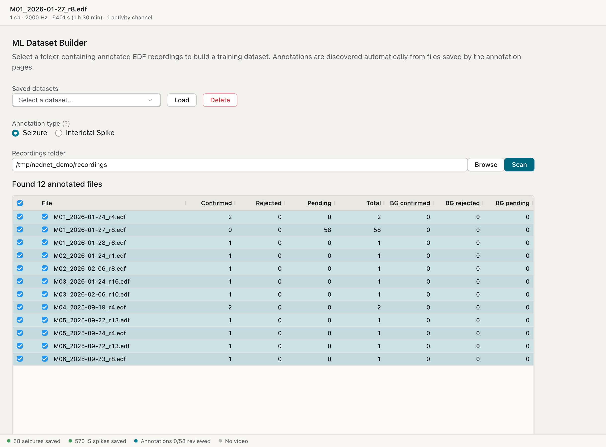

### 12.1 Building a dataset

1. Choose the **Annotation type**: Seizure or Interictal Spike.
2. Choose the **Recordings folder** and click **Scan**. The table lists every reviewed recording
   with Confirmed, Rejected, Pending and Total. Untick recordings to leave them out.
   - The summary cards split seizure labels into convulsive and non-convulsive.
   - A warning appears if a recording has no animal IDs.
3. Enter a **Dataset name** and click **Save Dataset**.

Saved datasets can be reloaded (**Load**, then **Scan** to refresh) or deleted.

### 12.2 Training

| Control | Default | Description |
|---|---|---|
| **Model name** | dataset name | Reusing a name overwrites that model |
| **Architecture** | U-Net | **U-Net** (Stage 1 detector) or **Convulsive Classifier** (Stage 2). For Interictal Spike datasets a spike model is trained |
| **Epochs** | 50 | Maximum passes over the data |
| **Batch size** | 8 | Windows per step |
| **Learning rate** | 0.001 | Step size |
| **Patience** | 10 | Stop after this many epochs without improvement; the best epoch is kept |
| **Pos weight** | 5.0 | Extra weight on seizure samples in the loss |
| **Neg/Pos ratio** | 2.0 | Negative windows per positive one |
| **Exclude animal IDs** | — | Animals left out entirely |

Validation is a fixed split **by animal**: 20% of animals are held out. This measures how well a
model works on animals it has not seen. Training needs reviewed events from **at least two
animals**.

Click **🚀 Start Training**. **■ Stop** ends early and keeps the best model so far.

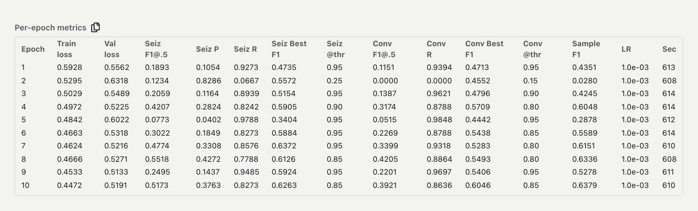

*The per-epoch table of a training run.*

The progress panel shows the settings in use and a live per-epoch table:
- train and validation loss;
- seizure F1, precision and recall at 0.5;
- the **best F1 over thresholds** and the threshold that gave it;
- the same for the convulsive output;
- learning rate and time per epoch.

The best epoch is highlighted.

**How the best model is chosen.** The saved model is the epoch with the highest **event F1 over
a sweep of thresholds** on the validation animals. That threshold is saved as the model's
*training optimum*. Events, not samples, are counted: a detection that overlaps a reviewed
seizure is a hit.

### 12.3 Models

- **U-Net.** A 1-D encoder–decoder with skip connections: 4 levels, 32 base filters, kernel 7.
  It outputs a seizure probability and a convulsive probability for every sample. Trained with
  Dice + BCE loss.
- **Convulsive classifier.** The same convolutional blocks, global pooling and a linear output,
  on 60 s crops around reviewed seizures.

Models are saved in `~/.eeg_seizure_analyzer/models/<name>/`:
- `best_model.pt`;
- `final_model.pt`;
- `metadata.json` (settings, metrics, training-optimum threshold).

To share a model, copy its folder into the other computer's `models/` folder.

### 12.4 Retraining for a new cohort

1. Run the current model on the new recordings in **Analysis**, with the output set to **Both**
   (database and review queue).
2. Review a sample in **Training**: confirm real seizures, reject false ones, and add missed
   ones in Browse mode.
3. Build a dataset with the old and the new recordings, then train a new model. Models are always
   trained from scratch on the whole dataset; they do not continue from an earlier model.

Some options exist only in the command-line trainers (section 20), e.g.:
- validation by recording or over time;
- using rejected events as negatives for the convulsive classifier;
- fully deterministic fp32 training.

---

## 13. Analysis

The **Analysis** tab runs a trained model on one file, a folder, or a watched folder. Its output
goes to a project database, the review queue, or both.

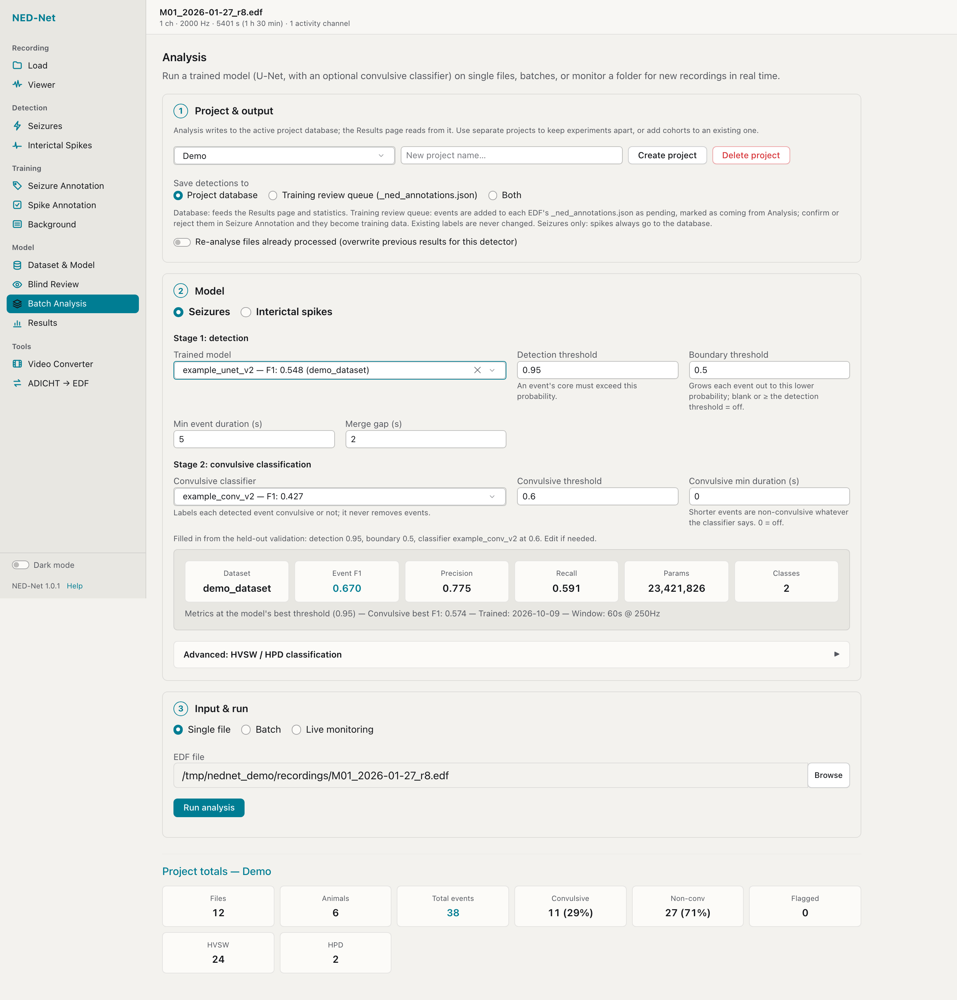

### 13.1 Step 1: Project and output

- **Project database:** the active project (section 15). **Create project** / **Delete
  project**.
- **Save detections to:**
  - **Project database:** for statistics in **Results**.
  - **Training review queue (`_ned_annotations.json`):** events are added to each recording's
    review queue as pending, marked as coming from Analysis. Existing labels are never changed.
  - **Both:** the usual choice for a new cohort.
  - Interictal spikes always go to the database.
- **Re-analyse files already processed:** off by default, so files already in the project are
  skipped. Turn it on to replace this detector's earlier results.

### 13.2 Step 2: Model

- **Seizures** or **Interictal spikes**.
- **Stage 1 (detection):**
  - **Trained model**;
  - **Detection threshold** and **Boundary threshold** (section 7.1);
  - **Min event duration (s)** (default 5) and **Merge gap (s)** (default 2).
- **Stage 2 (convulsive classification):** **Convulsive classifier**, or none (the U-Net's own
  convulsive output), **Convulsive threshold**, and **Convulsive min duration (s)** (section 7.2).

Choosing a model fills in its **recommended operating point** (section 7.3), and a note says
where it came from. If the validated classifier is not installed, the selected classifier is
kept with its own threshold.

The model card shows the model's validation metrics. **Advanced: HVSW / HPD classification** sets
the subtype thresholds:

| Parameter | Default | Description |
|---|---|---|
| **HVSW — max dominant freq (Hz)** | 4 | HVSW candidates have a dominant frequency below this |
| **HVSW — min slow-wave index** | 0.5 | Minimum fraction of power below that frequency |
| **HPD — min dominant freq (Hz)** | 15 | HPD candidates have a dominant frequency above this |
| **HPD — min HF index** | 0.3 | Minimum fraction of power above that frequency |

Subtypes apply to **non-convulsive** events:
- **HVSW:** slow, high-amplitude waves;
- **HPD:** fast periodic discharges;
- events that fit neither keep only the non-convulsive label.

### 13.3 Step 3: Input and run

- **Single file:** a path (defaults to the loaded recording), then **Run analysis**.
- **Batch:**
  1. a folder (optionally with subfolders);
  2. optionally a batch metadata spreadsheet mapping files to animal IDs, cohort and group
     (**Generate template** creates one pre-filled from the folder; **Save empty template**
     saves a blank one);
  3. **Scan folder** previews the files, and **Run batch analysis** starts the run.

  Progress is shown per file. **Pause** and **Cancel** work at any time.
- **Live monitoring** watches a folder and analyses each new EDF. Start with **Start
  monitoring**.
  - **Wait before processing (seconds)** (default 30) lets the acquisition software finish
    writing the file.
  - **Process backlog on startup** also analyses files already in the folder.
  - **Channel metadata template (optional)** sets animal IDs, cohort and group for incoming
    files; **Save empty template** saves a blank one to fill in.

  Live monitoring needs the `watchdog` package, which is installed with NED-Net.

### 13.4 Project totals

Below the run controls, **Project totals** summarises the whole active project: files, animals,
events, convulsive and non-convulsive counts, HVSW/HPD and flagged events. **Results** gives the
full picture.

---

## 14. Results

**Results** shows the statistics for one project.

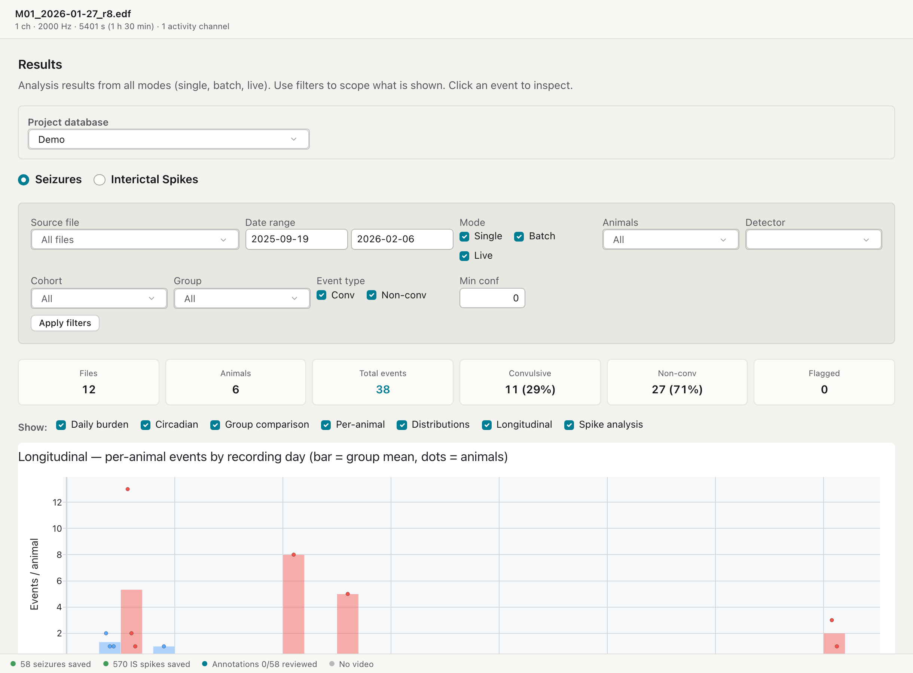

### 14.1 Choosing what to show

- **Project database** and **Seizures / Interictal Spikes** at the top.
- **Filters:** Source file, Date range, Mode (Single / Batch / Live), Animals, Detector, Cohort,
  Group, Event type (convulsive / non-convulsive), Min conf. Click **Apply filters**.
- Filters are remembered per project.
- **Show:** turns panels on and off: Daily burden, Circadian, Group comparison, Per-animal,
  Distributions, Longitudinal, Spike analysis.

### 14.2 Panels

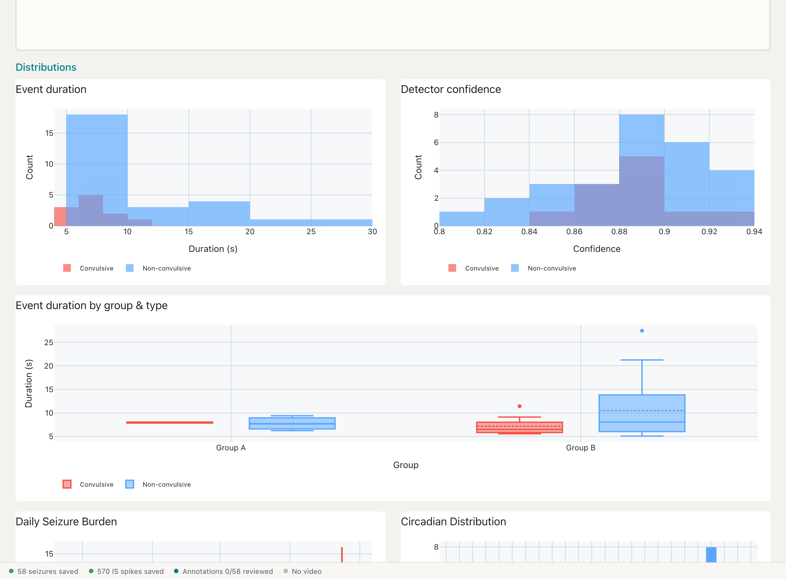

- **Metric cards:** files, animals, events, convulsive and non-convulsive (%), flagged.
- **Group & cohort comparison.**
  - **Normalise** shows **Raw counts** or **Per animal-hour**.
  - Per animal-hour divides events by the recorded time of each animal: the length of every file
    it appears in.
  - The table lists Animals, **Animal-files** (recordings summed over the group's animals),
    recorded hours, events and events/h.
- **Per-animal summary.** One row per animal: files, events, mean duration, recorded days and
  hours, **Coverage %** (relative to the best-recorded animal in its group), span and events/h.
  Three columns are editable:
  - **Include:** untick to drop an animal from all comparisons and plots;
  - **Rec start:** day 1 for the longitudinal plot;
  - **Valid until** (YYYY-MM-DD): drops events and recorded time after that date, e.g. if an
    animal died or an implant failed.

  Low coverage and censoring are flagged.
- **Distributions:** event duration, detector confidence, duration by group.
- **Longitudinal:** events per animal per recording day.
- **Daily burden** and **Circadian:** events per day and per hour of day.
- **Interictal spike analysis** (Spikes view): inter-spike interval distribution, cumulative
  ISI, diurnal profile.

### 14.3 Events table

The table lists the filtered events. Only the first 500 are shown, and the page says so; the
exports include all of them. **Exclude** removes an event from all summaries, plots and
exports. Clicking a row opens an inspector with the EEG around the event, if
the recording is available.

### 14.4 Exports

- **Export filtered CSV:** the current selection, without excluded events.
- **Export all events CSV:** everything, with the exclude flag.
- **Export graph data (XLSX):** the numbers behind the plots, one sheet per panel. The sheets
  are PerAnimal, PerGroup, daily counts and rates by group, circadian, duration per animal, and
  ISI sheets for spikes.

---

## 15. Projects and Batch Processing

### 15.1 Projects

A **project** is one SQLite database of detections, for example one per study.
- **Analysis** and **Add to project database** write to the **active project**; **Results**
  reads from it.
- Create, switch and delete projects in **Analysis**.
- The project "Default" is `~/.eeg_seizure_analyzer/analysis.db`. Other projects are in
  `~/.eeg_seizure_analyzer/projects/`.

Along with events, the database records which animals and files were analysed, and for how long.
This is what makes per-animal-hour rates possible, including for quiet animals with no events.

### 15.2 Rule-based detection on many files

With a folder loaded (**Load Multiple**), **📁 Detect All Files** on either Detection subtab runs
the current method and parameters on every file, with a progress bar.
- Results are saved next to each recording, and seizure candidates join each file's review queue.
- Ensemble is not available for Detect All.
- To get rule-based results into a project, use **Add to project database** on each file.

### 15.3 Trained models on many files

Use **Analysis → Batch** (or Live monitoring). For a cluster, use the headless batch detector
(section 20).

---

## 16. Parameters and Settings

**Parameters menu** (both Detection subtabs):

| Item | What it does |
|---|---|
| **Load my saved defaults** | Restore the parameters you saved |
| **Save current as my defaults** | Save the current parameters |
| **Reset to factory defaults** | Restore the built-in defaults |
| **Load the parameters used for this file's detections** | Restore the settings that produced the saved detections |

Saved defaults are in `~/.eeg_seizure_analyzer/defaults.json` (seizures) and
`spike_defaults.json` (spikes).

Other settings are remembered automatically within a session:
- Analysis choices;
- filters;
- inspector context and overview span;
- the Viewer settings.

Results filters are remembered per project between sessions.

---

## 17. Tools

### 17.1 Video Converter

Converts LabChart WMV recordings (`Record1.wmv`, `Record2.wmv`, …) into one MP4.
1. **Video folder:** **Browse**, then **Scan**. The scan lists the files with size, duration and
   totals.
2. **Output MP4 path:** pre-filled from the recording name.
3. **Convert & Merge.** Hardware encoding is used when available. Existing files are not
   overwritten.

Requires **ffmpeg** (macOS: `brew install ffmpeg`; Windows: [ffmpeg.org](https://ffmpeg.org/download.html)).
The page says whether it was found.

### 17.2 ADICHT → EDF (Windows only)

Converts LabChart files to EDF. Requires `pip install adi-reader`.
1. **ADICHT files:** one path per line, or **Browse** (several at once).
2. **Output folder:** leave empty to write next to the originals.
3. **Fast write mode** (on): much faster. Turn it off only if a file fails.
4. **Convert to EDF.** **Stop** cancels and removes the partial file. Existing files are not
   overwritten.

---

## 18. Files

### 18.1 Files next to each recording

| File | Contents | Written by |
|---|---|---|
| `<name>_ned_annotations.json` | **Seizure review state, and the only source of training data.** Every candidate with its label, edits, notes and origin | Training; a Detection run (as pending); Analysis with the review-queue output |
| `<name>_ned_detections.json` | The last seizure detection run on the Detection tab: events, parameters and filter settings, so the tab can restore itself | Detection → Seizure |
| `<name>_ned_spikes.json` | The last interictal-spike run | Detection → Interictal Spikes |
| `<name>_ned_spike_annotations.json` | Spike review state | Training → Interictal Spikes |
| `<name>_ned_channels.json` | Animal ID per channel | Load |
| `<name>_ned_meta.json` | Cohort and group per channel | Load |

**Annotations and detections are deliberately separate.**
- Training reads only `_ned_annotations.json`, and Training edits never change
  `_ned_detections.json`.
- After you edit a boundary in Training, the Detection tab still shows the detector's original
  boundaries. The annotation keeps both.
- Analysis never writes `_ned_detections.json`, so its events appear in Training but not in the
  Detection tab.

All files are plain JSON and can be read by your own scripts.

### 18.2 Annotation file

```json
{
  "annotations": [
    {
      "onset_sec": 1234.5, "offset_sec": 1267.8, "channel": 0,
      "label": "confirmed",
      "source": "detector",
      "original_onset_sec": 1236.0, "original_offset_sec": 1260.1,
      "annotator": "AB", "animal_id": "Mouse_01",
      "detector_confidence": 0.92, "notes": "", "event_id": 1,
      "features": {"detection_method": "ml_unet", "origin": "analysis_live",
                   "convulsive": true},
      "quality_metrics": {}
    }
  ]
}
```

| Field | Values |
|---|---|
| `label` | `pending`, `confirmed`, `rejected` |
| `source` | `detector`, or `manual` (added in Browse mode) |
| `original_onset_sec` / `original_offset_sec` | The detector's boundaries, kept after an edit |
| `features.origin` | `detection_tab`, `detect_all`, `analysis_single`, `analysis_batch`, `analysis_live`; missing for older files |

### 18.3 Detection file

```json
{
  "edf_path": "/path/to/recording.edf",
  "detector_name": "SpikeTrainSeizureDetector",
  "channels": [0, 1],
  "params": {},
  "filter_settings": {"filter_enabled": true, "filter_values": {}},
  "events": [
    {"onset_sec": 1234.5, "offset_sec": 1267.8, "duration_sec": 33.3, "channel": 0,
     "event_type": "seizure", "confidence": 0.92,
     "features": {"detection_method": "spike_train", "n_spikes": 47},
     "quality_metrics": {"local_baseline_ratio": 3.4}}
  ]
}
```

### 18.4 The settings folder `~/.eeg_seizure_analyzer/`

| Path | Contents |
|---|---|
| `models/` | Trained models |
| `datasets/` | Saved dataset definitions |
| `analysis.db`, `projects/`, `active_project.txt` | Project databases and the active project |
| `defaults.json`, `spike_defaults.json` | Saved detection parameters |
| `recent.json` | Recent files and folders |
| `results_state.json` | Results filters per project |
| `window.json` | Desktop window size |

---

## 19. Keyboard Shortcuts

Shortcuts do nothing while you are typing in a box.

**Training (review mode), seizures and spikes**

| Key | Action |
|---|---|
| `C` / `R` / `S` | Confirm / Reject / Skip |
| `V` | Toggle convulsive (seizures) |
| `←` or `,` / `→` or `.` | Previous / next event |
| `[` / `]` | Pan the view back / forward (seizures) |
| `\` | Centre the view on the event (seizures) |

**Detection tab (seizure and spike results)**

| Key | Action |
|---|---|
| `,` or `←` / `.` or `→` | Previous / next event in the table |
| `[` / `]` / `\` | Pan / centre the inspector (seizures) |

On some keyboard layouts `[`, `]` and `\` need AltGr or Option. The on-screen buttons do the same
thing.

---

## 20. Headless Use and HPC

Model training and batch detection also run without the app, e.g. on a cluster:

```bash
# Stage 1 U-Net (--analyze reports class balance and the split, then exits)
python -m eeg_seizure_analyzer.ml.train_unet --data-dir /path/to/edfs \
    --model-name my_unet --neg-source hard --val-mode animal --fp32

# Stage 2 convulsive classifier (rejected events as negatives)
python -m eeg_seizure_analyzer.ml.train_convulsive --data-dir /path/to/edfs \
    --model-name my_conv --conv-neg-from-rejected

# Batch detection into a project database, across all CPU cores
python scripts/slurm/detect_batch.py --edf-dir /path/to/edfs \
    --db-path ~/.eeg_seizure_analyzer/projects/my_project.db \
    --model my_unet --convulsive-model my_conv --workers 48
```

Each accepts `--help`. The trainers read the same `_ned_annotations.json` files as the app, and
models they save appear in the app. Example job scripts for SLURM clusters are in `scripts/slurm/`.

---

*NED-Net: Neural Event Detection Network. Licensed under the GNU GPL v3.0.*
